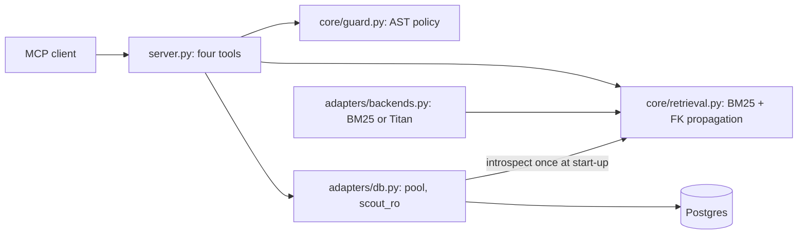

# Architecture



## Layout

```
src/postgres_schema_mcp/
  server.py            MCP entry point: the four tools, lazy start-up
  core/                pure logic, no I/O
    guard.py             the read-only AST policy
    retrieval.py         documents, tokenizer, BM25, SchemaIndex
    ddl.py               render a table as CREATE TABLE text
    types.py             the Pydantic models the tools return
  adapters/            all I/O
    db.py                connection pool, introspection, execution, EXPLAIN
    backends.py          choose BM25 or Titan (Bedrock) from the environment
```

## Rules

- `core/` is pure logic: no network, no disk, no model calls. It never imports from `adapters/`.
- `adapters/` does all I/O and is passed into `core/`. `SchemaIndex` takes a backend factory for this reason.
- `server.py` stays thin: parse, call `core/` and `adapters/`, return a model. It uses absolute imports because `mcp dev` loads it by path.

## One request

`search_schema` ranks the in-memory index and never touches the database after start-up. `run_query` and `explain_query` pass the SQL through `core/guard.py` first, then run it on a pooled connection as the `scout_ro` role, in an explicit `BEGIN READ ONLY` transaction over a server-side cursor, with a statement timeout, a row cap and size caps. The connection is reset when it returns to the pool. A rejected statement never reaches the database.

## Where the numbers come from

`evals/measure.py` builds the index from `evals/fixtures/catalog.json` and prints one JSON object to `evals/results/latest.json`. The README quotes it through eval markers that `scripts/check-readme-numbers.py` checks. `evals/check_live.py` and `evals/capture_catalog.py --check` run against the seeded database and prove the fixture and the allowed queries still hold. Figures that cannot be re-measured in CI (Titan on Bedrock, the conformance run) are recorded with a date and a source in `evals/baseline/`.

## Spec version

Built against MCP protocol revision 2026-07-28 on the official Python SDK `mcp==2.0.0`, pinned exactly because the v1 line continues in parallel and the two APIs are not compatible.

That revision made the protocol stateless. The `initialize` handshake, `notifications/initialized`, sessions and `Mcp-Session-Id` are gone, replaced by `server/discover` plus a per-request `_meta` envelope carrying the protocol version and the client's capabilities. There is no session handling anywhere in this codebase for that reason. Every result now carries a `resultType`, cacheable methods carry `ttlMs` and `cacheScope`, HTTP+SSE is deprecated in favour of stdio and Streamable HTTP, and sampling, roots and logging are deprecated. This server builds on none of them.

The v2 SDK also removed `FastMCP`: `from mcp.server.fastmcp import FastMCP` raises `ModuleNotFoundError`, and the entry point is `MCPServer` from `mcp.server`. The `fastmcp` package on PyPI is a separate project.

Two notes for reading the code against the docs:

- `mcp.types` is now a mirror of a standalone `mcp-types` package. Both spellings work.
- `ToolAnnotations` fields are snake_case in Python (`read_only_hint`) and camelCase on the wire (`readOnlyHint`). Both are accepted at runtime, but only snake_case type-checks under mypy, so the source uses snake_case and the README quotes the wire form.
